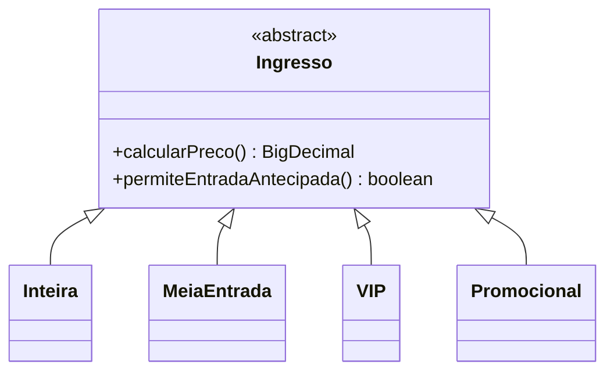

# Trabalho de Implementação — Programação Orientada a Objetos

## Sistema de Gestão de Eventos e Ingressos

**Versão 1.0 — Enunciado para os alunos**

## 1. Objetivo

Desenvolver, em **Java**, um sistema de gestão de eventos e vendas de ingressos, explorando **herança, polimorfismo, API de coleções, expressões lambda e Stream API**. A interface será construída com **Vaadin**, mas o foco da avaliação será a modelagem e a implementação das regras de negócio.

## 2. Contexto

Uma organização promove eventos culturais, esportivos e acadêmicos. Para cada evento, deseja registrar suas informações, comercializar ingressos em modalidades predefinidas e consultar dados de ocupação e arrecadação.

O sistema será utilizado localmente para fins didáticos: não haverá pagamento eletrônico, autenticação ou integração com sistemas externos.

## 3. Regras de negócio

### 3.1 Eventos

- Cada evento tem identificador único, título, descrição, data, horário de início, local, capacidade máxima e preço-base.
- Todos os eventos oferecem as **quatro modalidades fixas**: inteira, meia-entrada, VIP e promocional.
- A capacidade máxima limita a soma de todos os ingressos vendidos para o evento.
- Eventos passados podem ser consultados, mas não aceitam novas vendas.
- Não podem existir eventos com o mesmo identificador.
- Eventos podem ser cadastrados, mas não editados ou excluídos após o cadastro.

### 3.2 Modalidades de ingresso e polimorfismo

O preço final depende da modalidade:

| Modalidade | Regra de preço | Regra adicional |
|---|---|---|
| Inteira | 100% do preço-base | Sem exigência adicional |
| Meia-entrada | 50% do preço-base | Registrar justificativa (por exemplo, estudante ou idoso) |
| VIP | 150% do preço-base | Direito à entrada antecipada (60 minutos antes do início) |
| Promocional | Preço-base com desconto percentual | Respeitar o limite de ingressos promocionais do evento |

O **percentual de desconto** e o **limite de ingressos promocionais** são configurados individualmente para cada evento. As quatro modalidades, entretanto, são as mesmas em todos os eventos.

**Objetivo de POO:** as modalidades devem apresentar comportamentos próprios, especialmente no cálculo do preço. O projeto deve usar **herança e polimorfismo efetivos**, em vez de centralizar os cálculos em uma sequência de testes de tipo. **É obrigatório definir uma classe abstrata `Ingresso`, da qual derivam as quatro modalidades concretas** (`Inteira`, `MeiaEntrada`, `VIP` e `Promocional`, ou nomes equivalentes). O cálculo do preço e a identificação do direito à entrada antecipada devem ser polimórficos. As demais classes e relacionamentos são definidos pelos grupos.

### 3.3 Hierarquia obrigatória de ingressos

O diagrama apresenta **apenas a hierarquia obrigatória**. Os atributos, construtores e demais métodos são definidos pelos grupos. As assinaturas abaixo indicam as operações que deverão existir, podendo ser adaptadas de forma justificada ao modelo escolhido.

`calcularPreco()` utiliza os dados necessários à precificação, incluindo o preço-base do evento. `permiteEntradaAntecipada()` indica se o ingresso dá direito à entrada antecipada. Não é obrigatório adotar exatamente os nomes das subclasses apresentados.

### 3.4 Entrada antecipada e segundo comportamento polimórfico

- A entrada antecipada é um **benefício exclusivo do ingresso VIP**: seu portador poderá entrar até **60 minutos antes** do início do evento.
- Os ingressos inteira, meia-entrada e promocional **não** oferecem esse benefício.
- Não haverá controle de portões, simulação de autorização, registro de entradas ou verificação de horários pela interface.
- Cada tipo concreto de `Ingresso` deverá implementar polimorficamente `permiteEntradaAntecipada()`.
- A finalidade desse comportamento é permitir **consultas gerenciais**, como a quantidade de participantes com direito à entrada antecipada em cada evento, a partir da coleção heterogênea de ingressos vendidos.

### 3.5 Vendas e ingressos individuais

- Cada venda possui identificador único, evento, **nome do comprador**, data/hora da operação e uma coleção de **um ou mais ingressos individuais**.
- **Uma mesma venda pode incluir ingressos de diferentes modalidades**, em quaisquer combinações permitidas pelas regras do evento.
- Cada ingresso identifica **nome e CPF da pessoa que utilizará o ingresso**, que pode ser diferente do comprador. Não haverá cadastro separado de clientes ou participantes.
- Cada ingresso pertence a uma única venda e a um único evento (o evento da venda). Cada ingresso deve ter um identificador único.
- O mesmo CPF pode aparecer em vendas diferentes, mas não pode se repetir entre os ingressos de uma mesma venda.
- Cada ingresso possui uma modalidade entre inteira, meia-entrada, VIP e promocional. Para meia-entrada, registra-se também a justificativa da elegibilidade, sem necessidade de verificação documental.
- O valor total da venda corresponde à **soma dos preços de todos os ingressos** que a compõem, calculados segundo o tipo concreto de cada ingresso.
- A venda deve ser validada **como um todo antes de ser registrada**: se qualquer ingresso violar capacidade, cota promocional ou outra regra, nenhum ingresso da venda será incluído.
- Não é permitido vender ingressos para eventos passados. Não haverá cancelamento, reembolso nem pagamento eletrônico.
- O CPF será tratado como **identificador textual de 11 dígitos**, preservando zeros à esquerda. Não é exigida a implementação do algoritmo de validação dos dígitos verificadores.

### 3.6 Disponibilidade

- A disponibilidade geral de um evento corresponde à capacidade menos a quantidade total de ingressos vendidos.
- A disponibilidade promocional também depende da cota promocional remanescente.
- As consultas de disponibilidade devem ser coerentes com as vendas registradas.

## 4. Funcionalidades mínimas

1. Listar eventos e consultar seus detalhes.
2. Cadastrar um novo evento, incluindo os parâmetros da modalidade promocional.
3. Registrar uma venda para um evento, informando o comprador e uma lista de ingressos de modalidades possivelmente diferentes, com nome e CPF de cada participante e, quando aplicável, justificativa.
4. Impedir vendas que violem as regras de negócio, sem registrar parcialmente seus ingressos.
5. Consultar vendas, seus ingressos individuais e a disponibilidade de determinado evento.
6. Listar eventos futuros e eventos já realizados.
7. Consultar a arrecadação e a ocupação de um evento.
8. Disponibilizar as seguintes **consultas gerenciais obrigatórias**, como parte das funcionalidades mínimas:
   - Eventos futuros ordenados por data.
   - Eventos filtrados por período ou local.
   - Quantidade de ingressos vendidos por evento.
   - Arrecadação total por evento.
   - Arrecadação agrupada por modalidade.
   - Ranking de eventos por quantidade de ingressos vendidos.
   - Percentual de ocupação de cada evento.
   - Modalidade mais vendida em um evento.
   - Quantidade de participantes com direito à entrada antecipada, por evento.

As consultas deverão utilizar, de maneira adequada, a **API de coleções Java**, expressões lambda e a **Stream API**. São esperadas operações como `filter`, `map`, `sorted` e coletores como `groupingBy` e `summingInt`, quando pertinentes. Não é necessário empregar cada operação artificialmente.

**Esclarecimento de requisitos:** se uma regra de negócio necessária à implementação não estiver definida de maneira suficiente, o grupo deverá formular a dúvida e solicitar esclarecimento ao professor antes de assumir um comportamento. As decisões esclarecidas deverão ser documentadas no `README.md`.

## 5. Dados iniciais fornecidos

Os dados para demonstração devem ser **carregados a partir de arquivos-texto CSV**, e não cadastrados manualmente a cada execução. Serão fornecidos:

- `eventos.csv`: dados básicos dos eventos, incluindo horário de início.
- `modalidades_evento.csv`: desconto e cota promocionais por evento.
- `vendas.csv`: cabeçalhos das vendas de exemplo, incluindo nome do comprador.
- `ingressos.csv`: ingressos individuais vinculados às vendas, com modalidade, nome, CPF do participante e justificativa quando necessária.
- Código-base Java para leitura dos arquivos e conversão de linhas em registros de dados.

Os arquivos usam **ponto e vírgula (`;`)** como separador, cabeçalho na primeira linha, datas em ISO (`AAAA-MM-DD`) e data/hora em ISO (`AAAA-MM-DDTHH:MM:SS`). O código-base não implementa as regras de negócio: cabe aos grupos validar os dados e incorporá-los ao modelo que desenvolverem.

A carga inicial deve permitir demonstrar eventos futuros e passados, **vendas com ingressos de modalidades diferentes na mesma venda**, relatórios de vendas, ocupação e entrada antecipada. **Tentativas de venda inválida** serão demonstradas pela interface, não precisam constar nos arquivos CSV.

## 6. Requisitos técnicos

- Linguagem **Java** e interface **Vaadin**.
- Dados de trabalho mantidos **em memória**; não é exigido banco de dados nem gravação das alterações em arquivos.
- Carregamento inicial obrigatório a partir dos CSV fornecidos, usando ou adaptando o leitor Java disponibilizado.
- **Classe abstrata `Ingresso` obrigatória**, com subclasses concretas para as quatro modalidades, e uso significativo de polimorfismo **no cálculo dos preços e na identificação do direito à entrada antecipada**.
- Uso de coleções, expressões lambda e Stream API nas consultas.
- Separação entre lógica de negócio e interface Vaadin.
- Fora a hierarquia obrigatória de `Ingresso`, a escolha das demais classes, dos relacionamentos e da organização do código fica a cargo de cada grupo.
- **Testes automatizados não serão exigidos.**

## 7. Entrega e demonstração

- Entrega do código-fonte em repositório Git.
- `README.md` com instruções de execução, breve explicação das decisões de modelagem e registro dos esclarecimentos de requisitos obtidos durante o desenvolvimento.
- Demonstração funcional pela interface Vaadin, incluindo carga de dados, uma venda válida com ingressos de modalidades diferentes, uma tentativa de venda inválida, e consultas gerenciais, incluindo a quantidade de participantes com direito à entrada antecipada.
- Explicação de um exemplo concreto de polimorfismo e de consultas com Stream API.
- **Defesa das decisões de implementação:** durante a apresentação, todos os integrantes deverão ser capazes de explicar as partes do sistema em que trabalharam, as escolhas de classes e relacionamentos, o uso de herança, polimorfismo, coleções e Streams, bem como as principais regras e validações. O professor poderá solicitar a explicação de trechos do código e pequenas alterações ou demonstrações.
- O uso de ferramentas de apoio, inclusive inteligência artificial, não substitui o domínio da solução apresentada. Código que os integrantes não consigam explicar adequadamente não demonstra aprendizagem dos conceitos avaliados.

---

